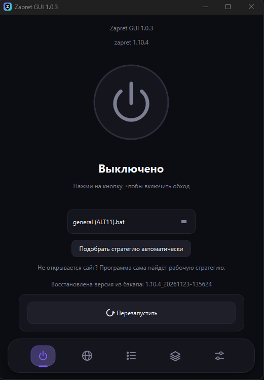

<p align="center">
  
</p>

<p align="center">
  <a href="https://github.com/trianglenk/Zapret-GUI/releases/latest"></a>
  <a href="https://github.com/trianglenk/Zapret-GUI/releases"></a>
  
  <a href="LICENSE"></a>
</p>

# Zapret GUI

Графическая оболочка для [zapret-discord-youtube](https://github.com/Flowseal/zapret-discord-youtube): включение обхода в один клик, без окон `.bat` и значков на панели задач.

> Сам zapret в этом репозитории не хранится. Программа скачивает его из репозитория Flowseal и обновляет оттуда же. Проект не связан с авторами zapret.

<div align="center">
  
</div>
## Возможности

- **Включение одной кнопкой**, обход работает скрыто (без окна `winws`). Выключение полностью останавливает `winws`, службу `zapret` и драйвер WinDivert.
- **Значок в трее**: зелёный круг, когда обход работает, красный, когда выключен. Закрытие окна сворачивает программу в трей.
- **Стратегии**: переключение между `general (ALT…)`, автоматический подбор рабочей, при смене сервис перезапускается сам.
- **Профили доменов** (Telegram, Discord, свои) и редактор списков.
- **Сайты**: карточки со статусом и временем ответа, сводка «доступно N из M», быстрое добавление популярных сайтов, автопроверка после включения обхода.
- **zapret и его списки обновляются сами** с GitHub (списки берутся из официальной папки `lists`), старые версии сохраняются в `backup`.
- **Диагностика**: права, файлы zapret, WinDivert, списки, доступ к GitHub.
- **Приложение обновляется само** из релизов этого репозитория (стабильные или пререлизы), с бэкапами и откатом на прежнюю версию.
- Темы (фиолетовая, зелёная, светлые, как в системе), цвет акцента, шрифт, углы, плотность, отключаемые анимации. Адаптивный вид: узкое окно как в телефоне, широкое с боковой панелью.

## Установка

1. Скачай `ZapretGUI-Setup.zip` из [последнего релиза](https://github.com/trianglenk/Zapret-GUI/releases/latest) и распакуй.
2. Запусти `ZapretGUI-Setup.exe`, выбери папку (по умолчанию `C:\Program Files\Zapret GUI`).
3. Запускай через меню «Пуск» или ярлык. Программа попросит права администратора: они нужны драйверу WinDivert.

В установленной папке лежит всё вместе:

```
Zapret GUI\
  ZapretGUI.exe   программа
  release\        рабочая версия zapret
  backup\         бэкапы старых версий zapret
  app_backup\     бэкапы старых версий приложения
  downloads\      скачанные архивы
  profiles\       профили доменов
  config.json     настройки
```

### Windows 7

Для Windows 7 есть отдельная сборка `ZapretGUI-Win7.exe` (Python 3.8 и Qt 5.15: PySide6 на Windows 7 не запускается), она лежит в тех же релизах. Что ещё нужно:

- Windows 7 SP1 x64 с обновлениями KB3033929 и KB4474419 (подпись драйверов SHA-2).
- В `release\bin` заменить `WinDivert.dll` и `WinDivert64.sys` файлами из папки `win7` репозитория [bol-van/zapret-win-bundle](https://github.com/bol-van/zapret-win-bundle).

Работу zapret на Windows 7 гарантировать нельзя: набор Flowseal рассчитан на Windows 10/11. Приложение при обновлении само берёт файл `ZapretGUI-Win7.exe`.

Если антивирус ругается на свежескачанный `.exe`, добавь папку установки в исключения: программы на PyInstaller и драйвер WinDivert часто попадают под ложные срабатывания.

## Обновления и откат

**Ещё → Приложение**: проверка новой версии, выбор канала (стабильные или пререлизы), установка любой версии из списка релизов. Перед обновлением текущая версия сохраняется в `app_backup`, и на неё можно вернуться кнопкой «Откатиться на выбранную».

## Запуск из исходников

```
python -m venv .venv
.venv\Scripts\python.exe -m pip install -r requirements.txt
.venv\Scripts\python.exe main.py
```

Сборка `.exe` и установщика: `build.bat` (нужны Python и Inno Setup 6). Для Windows 7: `build-win7.bat` (нужен Python 3.8 x64).

## Тесты

```
python -m unittest discover -s tests -v
```

Проверяют настройки (старые и повреждённые `config.json`, сохранение и чтение), оформление (темы, 14 акцентов, плотность, читаемость текста на акценте) и логику интерфейса на заглушке Qt. Внешний вид (раскладка, анимации, ресайз окна) тесты не проверяют, его нужно смотреть глазами.

## Выпуск новой версии

Проще всего скриптом: подними `VERSION` в `version.py`, допиши `CHANGELOG.md` и запусти `publish.bat`. Он сделает коммит, отправит его в `main` и создаст тег `v<версия>`.

Вручную:

1. Обнови `CHANGELOG.md`, сделай коммит и отправь его в `main`.
2. Создай тег и отправь его:
   ```
   git tag v1.0.3
   git push origin v1.0.3
   ```
   Для пререлиза тег с суффиксом: `v1.0.3-beta.1`.
3. GitHub Actions соберёт `ZapretGUI.exe`, `ZapretGUI-Win7.exe` и установщики и опубликует релиз. Версия приложения берётся из тега.

## Лицензия

[MIT](LICENSE)

## Обновление интерфейса 1.0.2.1

- Разделы настроек «О приложении», «zapret», «Приложение», «Папки и версии», «Управление версиями», «Диагностика», «Журнал», «Оформление» и «Поведение» можно сворачивать независимо друг от друга.
- Состояние каждого раздела сохраняется. В блоке «Поведение» можно заранее выбрать, какие разделы должны быть свёрнуты.
- Для раскрытия доступны стили анимации: плавная, быстрая и ненавязчивая; анимации можно полностью отключить.
- Добавлены цветовые темы «Океаническая», «Розовая» и «Янтарная».
- В профилях появились поиск, счётчик доменов и экспорт выбранного профиля.
