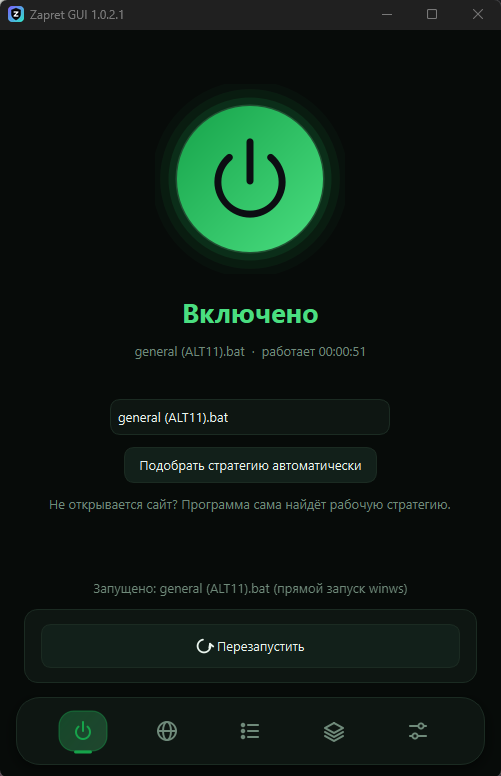
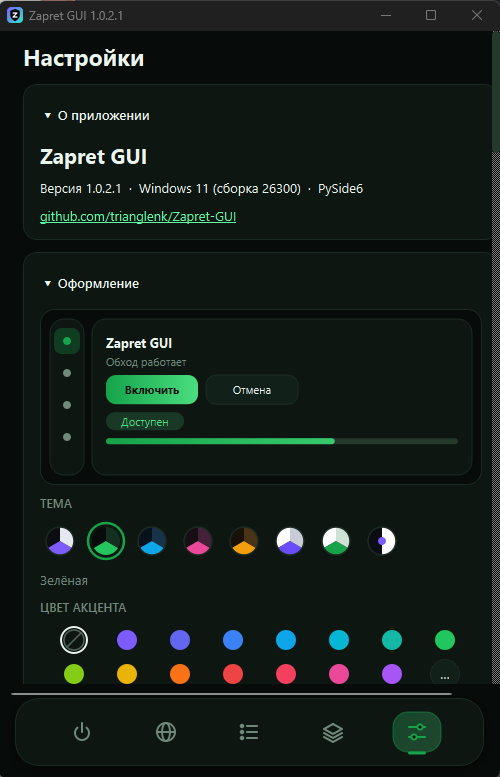

 <div align="center">
  
</div>

 <div align="center">
  Zapret GUI
**Графическая оболочка для Windows для управления zapret без ручного редактирования батников и конфигов.**


</div>

## Возможности
 <div align="center">
  
</div>


- Запуск, остановка и перезапуск службы/процесса `zapret`.
- Переключение профилей и стратегий обхода.
- Настройка параметров приложения.
- Проверка и установка обновлений через GitHub Releases.

## Скриншоты

<div align="center">
  
  
</div>

## Установка

1. Откройте **[Releases](https://github.com/trianglenk/Zapret-GUI/releases)**.
2. Скачайте `ZapretGUI-Setup.exe` из последнего релиза.
3. Запустите установщик от имени администратора и следуйте инструкциям.

> Для автообновления укажите в настройках репозиторий: `trianglenk/Zapret-GUI`.

## Сборка из исходников

Установите:

1. **Python 3.11 x64** — [python.org](https://www.python.org/downloads/windows/)  
   При установке включите **Add Python to PATH**.
2. **Inno Setup 6** — [jrsoftware.org](https://jrsoftware.org) или:
   ```powershell
   winget install JRSoftware.InnoSetup
    Git for Windows — git-scm.com.

Сборка:

    Клонируйте репозиторий или скачайте исходники.

    Запустите build.bat.

    Готовый установщик появится в installer/ZapretGUI-Setup.exe.

CI

GitHub Actions берёт версию из тега, собирает ZapretGUI.exe, упаковывает в ZapretGUI-Setup.exe и публикует релиз в Releases.
Структура проекта

    main.py — графический интерфейс.

    core.py — логика работы с zapret.

    version.py — версия приложения (1.0.2).

    requirements.txt — зависимости Python.

text


Исправлены ссылки на актуальный репозиторий, заменены пустые Shields, убраны повторы и сокращены разделы установки/сборки.
